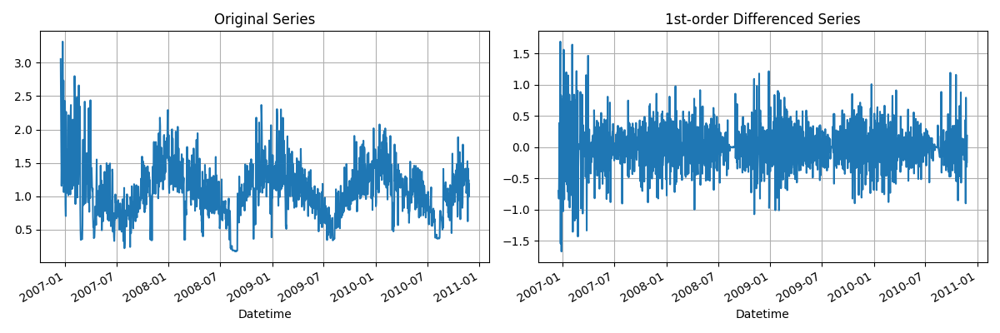
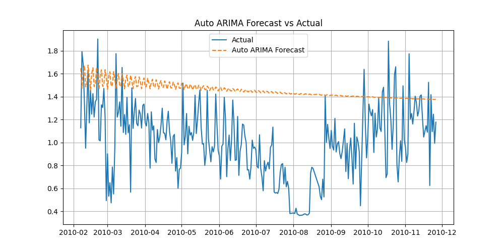
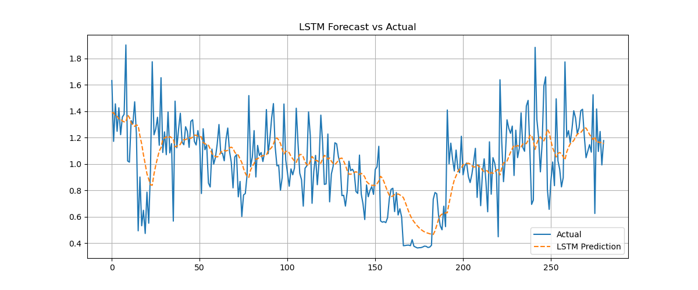
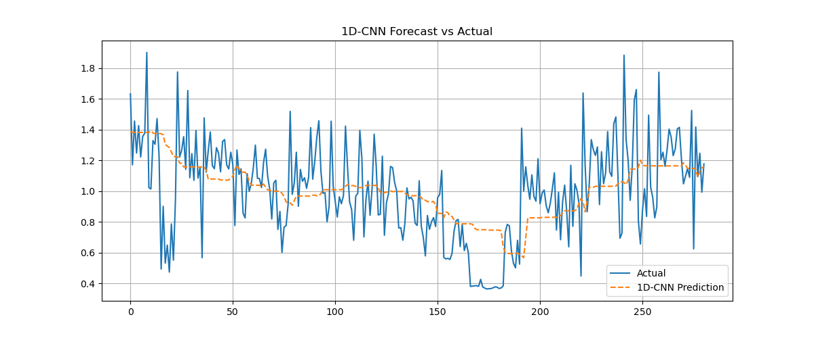

# 가정용 전력 소비량 시계열 예측

일 단위 가정용 전력 소비량(`Global_active_power`)을 **통계 모델(AR, MA, ARIMA, Auto ARIMA)**과 **딥러닝 모델(LSTM, 1D-CNN)**로 예측하고, 예측 성능(MSE)을 비교했습니다.

## 데이터셋

- 파일: `project_electric/household_power_consumption2.csv` (UCI Household Power Consumption 일부, 구분자 `;`, 약 28,000행, 1분 단위)
- 컬럼: `Date`, `Time`, `Global_active_power`, `Global_reactive_power`, `Voltage`, `Global_intensity`, `Sub_metering_1~3`

## 소스 구성

| 파일 | 모델 | 내용 |
| --- | --- | --- |
| `read_data_ar_ma.py` | AR / MA | `AutoReg`, `ARIMA(0,0,10)` 예측 |
| `read_data_arima.py` | ARIMA(5,1,2) | ADF 검정으로 정상성 확인, 1차 차분 후 예측 |
| `read_data_arima_pwd.py` | Auto ARIMA | `pmdarima.auto_arima`로 최적 차수 자동 탐색 |
| `read_data_lstm.py` | LSTM | PyTorch LSTM 시퀀스 예측 |
| `read_data_1d_cnn.py` | 1D-CNN | PyTorch 1D-CNN 시퀀스 예측 |
| `read_data.py` | 1D-CNN | `read_data_1d_cnn.py`와 같은 내용 |

## 분석 내용

1. **전처리**: 날짜와 시간을 합쳐 시간 인덱스를 만들고, 수치로 변환하고, 결측치를 제거한 뒤 **1일 평균으로 리샘플링**합니다.
2. **통계 모델**: 정상성 검정(ADF)과 차분을 거쳐 AR, MA, ARIMA, Auto ARIMA로 예측합니다.
3. **딥러닝 모델**: MinMax 정규화 후 시퀀스 데이터를 만들고, LSTM과 1D-CNN을 학습합니다.
4. **평가**: 테스트 구간의 예측값과 실제값으로 MSE를 계산하고, 비교 그래프를 저장합니다.

## 결과

| ARIMA | Auto ARIMA | LSTM | 1D-CNN |
| --- | --- | --- | --- |
|  |  |  |  |

AR·MA 결과는 `read_data_ar_ma_1.png`, `read_data_ar_ma_2.png`, `read_data_ar_ma_forecast.png`에 있습니다. 모델별 MSE는 각 스크립트를 실행하면 콘솔에 출력됩니다.

## 실행 방법

```bash
pip install pandas numpy matplotlib scikit-learn statsmodels pmdarima torch
cd project_electric
python read_data_arima.py
python read_data_lstm.py
```
